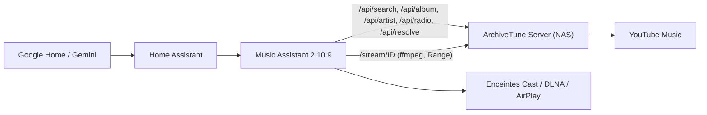

# Fournisseur Music Assistant « ArchiveTune »

Ce dossier contient un fournisseur de musique pour **Music Assistant 2.10.x** qui remplace yt-dlp / ytmusicapi par des appels HTTP vers **ton ArchiveTune Server**. Music Assistant gère la file d'attente, Cast, le fondu enchaîné et l'intégration Home Assistant ; ArchiveTune Server fournit la recherche et le flux audio.



## Ce que le fournisseur sait faire

- Recherche de titres, albums et artistes (une seule requête `type=all` quand plusieurs types sont demandés).
- Pages album (liste des titres), artiste (albums, singles, titres populaires) et titres similaires (radio du serveur).
- Lecture : flux HTTP `/stream/ID` du serveur, avec saut dans le morceau (`Range`).
- Token optionnel (`ARCHIVETUNE_TOKEN`), envoyé en `Authorization: Bearer` pour l'API et en `?token=` pour le flux (ffmpeg).

Il ne gère pas : bibliothèque personnelle, playlists, podcasts, recommandations de la page d'accueil, paroles. Le serveur n'expose pas ces données aujourd'hui.

## Prérequis

- ArchiveTune Server en marche et joignable depuis Music Assistant (test : ouvrir `http://IP_DU_NAS:8780/api/health`).
- Home Assistant OS avec l'add-on **Music Assistant** 2.10.x.
- L'add-on **Advanced SSH & Web Terminal** avec le **mode protégé désactivé** (nécessaire pour la commande `docker`).

## Installation (Home Assistant OS)

1. Ouvre le terminal de l'add-on Advanced SSH & Web Terminal.
2. Lance :

   ```
   curl -fsSL https://raw.githubusercontent.com/sam73368/ArchiveTune/main/server/music-assistant/scripts/install_provider.sh | sh
   ```

   Le script télécharge les 6 fichiers du fournisseur, détecte le conteneur Music Assistant et la version de Python, copie le dossier `archivetune` dans `music_assistant/providers/` et redémarre le conteneur.
3. Dans Music Assistant : **Paramètres → Fournisseurs → Ajouter un fournisseur → ArchiveTune**.
4. Renseigne l'adresse du serveur (par exemple `http://192.168.1.50:8780`) et le token si tu en utilises un.
5. Si le script ne trouve pas le conteneur : `docker ps -a | grep -i music`, puis relance avec `--ma-id NOM_DU_CONTENEUR`. Les autres options : `--ref BRANCHE_OU_TAG`, `--python-version python3.13`, `--no-restart`, `--local DOSSIER`.

### Après un redémarrage ou une mise à jour de Home Assistant

Le Supervisor recrée le conteneur Music Assistant et efface les fichiers copiés. Il suffit de relancer la même commande ; la configuration du fournisseur (URL, token) est conservée dans Music Assistant. Un add-on « watcher » qui réinstalle automatiquement n'est pas encore fourni.

## Utilisation

- Dans Music Assistant : recherche un titre, un album ou un artiste ; les résultats d'ArchiveTune apparaissent avec les autres fournisseurs.
- Dans Home Assistant : `media_player.play_media` avec le lecteur Music Assistant, `media_content_type: music` et le nom du titre ou de l'artiste, ou l'action `music_assistant.play_media`.
- Avec Gemini / Google Home : expose le lecteur Music Assistant à Home Assistant, puis demande « joue X sur <lecteur> ».

## Identifiants

- Titre : identifiant YouTube à 11 caractères.
- Album : `browseId` (`MPRE…`).
- Artiste : `browseId` (`UC…`) quand il vient d'une recherche ; `name:Nom de l'artiste` quand il vient d'un titre (le serveur ne donne que le nom). Le fournisseur retrouve alors l'identifiant réel par une recherche d'artiste, avec mémoire en cache.

## Dépannage

| Symptôme | Cause probable |
| --- | --- |
| « Cannot reach ArchiveTune Server » | URL fausse, pare-feu, serveur arrêté ; tester `/api/health` depuis le conteneur Music Assistant |
| « ArchiveTune Server refused the token » | `ARCHIVETUNE_TOKEN` différent de celui saisi |
| Le fournisseur n'apparaît pas | fichiers effacés après un redémarrage de Home Assistant : relancer le script |
| Silence au lancement d'un titre | tester `http://IP:8780/stream/ID` dans un navigateur ; regarder les journaux du serveur (« stream … upstream answered ») |

## Tests

Les tests utilisent un faux ArchiveTune Server (aiohttp), les vrais modèles `music_assistant_models` et une doublure minimale de `music_assistant` (le paquet complet exige Python 3.14).

```
pip install music-assistant-models aiohttp pytest pytest-asyncio
cd server/music-assistant
python -m pytest
sh tests/test_install_script.sh
```

Les tests ne remplacent pas un essai sur le vrai Music Assistant 2.10.9.
