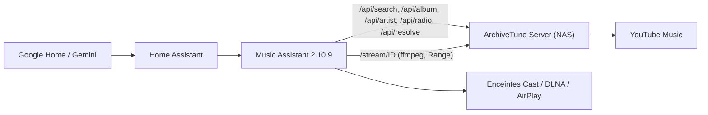

# Fournisseur Music Assistant « ArchiveTune »

Ce dossier contient un fournisseur de musique pour **Music Assistant 2.10.x** qui remplace yt-dlp / ytmusicapi par des appels HTTP vers **ton ArchiveTune Server**. Music Assistant gère la file d'attente, Cast, le fondu enchaîné et l'intégration Home Assistant ; ArchiveTune Server fournit la recherche et le flux audio.



## Ce que le fournisseur sait faire

- Recherche de titres, albums et artistes (une seule requête `type=all` quand plusieurs types sont demandés).
- Pages album (liste des titres), artiste (albums, singles, titres populaires) et titres similaires (radio du serveur).
- Lecture : flux HTTP `/stream/ID` du serveur, avec saut dans le morceau (`Range`).
- Token optionnel (`ARCHIVETUNE_TOKEN`), envoyé en `Authorization: Bearer` pour l'API et en `?token=` pour le flux (ffmpeg).

Il ne gère pas : bibliothèque personnelle, playlists, podcasts, recommandations de la page d'accueil, paroles. Le serveur n'expose pas ces données aujourd'hui.

## Prérequis

- ArchiveTune Server en marche et joignable depuis Music Assistant (test : ouvrir `http://IP_DU_NAS:8780/api/health`).
- Home Assistant OS avec l'add-on **Music Assistant** 2.10.x.
- L'add-on **Advanced SSH & Web Terminal** avec le **mode protégé désactivé** (nécessaire pour la commande `docker`).

## Installation (Home Assistant OS) : une seule fois

1. Ouvre le terminal de l'add-on **Advanced SSH & Web Terminal** (mode protégé désactivé).
2. Lance :

   ```
   curl -fsSL https://raw.githubusercontent.com/sam73368/ArchiveTune/main/server/music-assistant/scripts/install_watcher_addon.sh | sh
   ```

   Le script crée l'add-on local **ArchiveTune Provider Watcher**, puis essaie de l'installer, de désactiver son mode protégé et de le démarrer avec la commande `ha`. S'il n'y arrive pas, il affiche les 4 gestes à faire à la main (Boutique d'add-ons → Rechercher les mises à jour → Installer → Mode protégé désactivé → Démarrer).
3. Dans le journal de l'add-on, tu dois voir `Music Assistant restarted`.
4. Dans Music Assistant : **Paramètres → Fournisseurs → Ajouter un fournisseur → ArchiveTune**, puis l'adresse du serveur (par exemple `http://192.168.1.50:8780`) et le token.

Ensuite, plus rien à faire. L'add-on démarre avec Home Assistant et surveille Music Assistant toutes les 10 secondes :

- si le conteneur Music Assistant est recréé (redémarrage ou mise à jour de Home Assistant, mise à jour de Music Assistant, changement de version de Python), il recopie le fournisseur et redémarre Music Assistant (quelques secondes) ;
- si les fichiers sont déjà en place et identiques, il ne touche à rien ;
- toutes les 6 heures, il vérifie GitHub et installe automatiquement une nouvelle version du fournisseur, seulement si le code a changé. Si GitHub est injoignable ou si les fichiers téléchargés sont invalides, il garde la version en place (une copie est aussi embarquée dans l'add-on) ;
- une mise à jour du fournisseur redémarre Music Assistant : la lecture en cours s'arrête quelques secondes.

Options de l'add-on (onglet Configuration) : `auto_update` (activé par défaut), `update_interval_hours` (6) et `ref` (branche ou tag à suivre, `main`).

### Alternative manuelle

`scripts/install_provider.sh` copie le fournisseur une fois dans le conteneur, sans add-on. Il faut le relancer après chaque recréation du conteneur. Options : `--ref`, `--ma-id`, `--python-version`, `--no-restart`, `--local DOSSIER`.

## Utilisation

- Dans Music Assistant : recherche un titre, un album ou un artiste ; les résultats d'ArchiveTune apparaissent avec les autres fournisseurs.
- Dans Home Assistant : `media_player.play_media` avec le lecteur Music Assistant, `media_content_type: music` et le nom du titre ou de l'artiste, ou l'action `music_assistant.play_media`.
- Avec Gemini / Google Home : expose le lecteur Music Assistant à Home Assistant, puis demande « joue X sur <lecteur> ».

## Identifiants

- Titre : identifiant YouTube à 11 caractères.
- Album : `browseId` (`MPRE…`).
- Artiste : `browseId` (`UC…`) quand il vient d'une recherche ; `name:Nom de l'artiste` quand il vient d'un titre (le serveur ne donne que le nom). Le fournisseur retrouve alors l'identifiant réel par une recherche d'artiste, avec mémoire en cache.

## Dépannage

| Symptôme | Cause probable |
| --- | --- |
| « Cannot reach ArchiveTune Server » | URL fausse, pare-feu, serveur arrêté ; tester `/api/health` depuis le conteneur Music Assistant |
| « ArchiveTune Server refused the token » | `ARCHIVETUNE_TOKEN` différent de celui saisi |
| Le fournisseur n'apparaît pas | ouvrir le journal de l'add-on Watcher : « no Docker access » = mode protégé encore activé ; « no Python found » ou « missing inside » = conteneur Music Assistant introuvable ou pas prêt (il réessaie seul) |
| Silence au lancement d'un titre | tester `http://IP:8780/stream/ID` dans un navigateur ; regarder les journaux du serveur (« stream … upstream answered ») |

## Tests

Les tests utilisent un faux ArchiveTune Server (aiohttp), les vrais modèles `music_assistant_models` et une doublure minimale de `music_assistant` (le paquet complet exige Python 3.14).

```
pip install music-assistant-models aiohttp pytest pytest-asyncio
cd server/music-assistant
python -m pytest
sh tests/test_install_script.sh
sh tests/test_install_watcher.sh
bash tests/test_watcher.sh
```

Les tests ne remplacent pas un essai sur le vrai Music Assistant 2.10.9.
